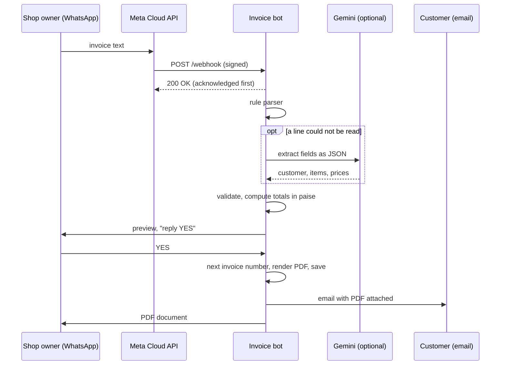

# WhatsApp Invoice Automation

Send a WhatsApp message, get a PDF invoice. A shop owner texts the customer and the items; the
bot replies with a preview, and after a **YES** it numbers the invoice, renders the PDF, emails it
to the customer and sends the PDF back in the chat.

It is a small TypeScript service built on Meta's WhatsApp Cloud API. There is no workflow tool and
no external PDF service: parsing, arithmetic, PDF rendering and storage are all in this codebase.

```
You:  invoice for Rahul Sharma, rahul@example.com
      2 x Notebook @ 45
      Pen x 3 @ 10
      gst 18

Bot:  *Invoice preview*
      Customer: Rahul Sharma
      Email: rahul@example.com

      1. Notebook: 2 x Rs. 45.00 = Rs. 90.00
      2. Pen: 3 x Rs. 10.00 = Rs. 30.00

      Subtotal: Rs. 120.00
      GST 18%: Rs. 21.60
      *Total: Rs. 141.60*

      Reply *YES* to create and send it, or *NO* to cancel.

You:  yes

Bot:  [INV-2026-0001.pdf]  Invoice INV-2026-0001 for Rahul Sharma: Rs. 141.60
      Emailed to rahul@example.com.
```

A generated invoice: [`docs/sample-invoice.pdf`](docs/sample-invoice.pdf).

## Contents

- [How it works](#how-it-works)
- [Message format](#message-format)
- [Try it locally](#try-it-locally)
- [Connect it to WhatsApp](#connect-it-to-whatsapp)
- [Configuration](#configuration)
- [Design decisions](#design-decisions)
- [Project structure](#project-structure)
- [Limitations](#limitations)

## How it works



1. **Webhook.** Meta posts each incoming message to `/webhook`. The request's HMAC signature is
   checked, the request is acknowledged, and the message is processed afterwards.
2. **Parsing.** A deterministic rule parser handles the documented format. If it cannot read a
   line and a Gemini API key is configured, the message goes to Gemini, which returns structured
   JSON. Either way the result must pass the same schema validation.
3. **Totals.** All amounts are computed in code, in integer paise.
4. **Preview and confirmation.** Nothing is created until the sender replies YES. A preview
   expires after 15 minutes.
5. **Invoice.** The bot assigns the next sequential number, renders the PDF, saves it, emails it if
   the customer's email is known, and sends the PDF back on WhatsApp.

## Message format

One item per line (or separate lines with `;`). Only the customer and one item are required.

| Line | Examples |
|---|---|
| Customer | `invoice for Rahul Sharma, rahul@example.com` · `bill to Asha, 98765 43210` · `name: Rahul` |
| Item, quantity first | `2 x Notebook @ 45` · `2 Notebook 45` · `2 kg Rice @ 60` |
| Item, name first | `Pen x 3 @ 10` · `T-shirt x2 299` |
| Item, quantity 1 | `Stapler - 120` · `Marker: Rs. 30.50` |
| Tax | `gst 18` · `tax 5%` |
| Discount | `discount 5%` · `discount 50` |
| Note | `note: Thank you!` |
| Email / phone on their own line | `email: rahul@example.com` · `phone: 9876543210` |

Commands: `help` shows the format, `yes` confirms the preview, `no` cancels it.

With a Gemini key set, free-form messages also work, for example
`bill rahul for two notebooks at 45 each and a pen for ten rupees, 18% gst`.

## Try it locally

You need [Node.js](https://nodejs.org/) 20 or newer. No WhatsApp account, API key or mail server
is required for this.

```bash
git clone https://github.com/KevalMGajjar/whatsapp-invoice-automation.git
cd whatsapp-invoice-automation
npm install
cp .env.example .env        # optional: set BUSINESS_NAME and friends
```

**One-off, from the terminal.** This prints the preview, confirms it, and writes the PDF to
`data/invoices/`:

```bash
npm run simulate -- --yes "invoice for Rahul Sharma, rahul@example.com; 2 x Notebook @ 45; Pen x 3 @ 10; gst 18"
```

**As a server.** Without a WhatsApp token the bot runs in console mode, and a development-only
endpoint stands in for WhatsApp:

```bash
npm run dev
```

```bash
curl -X POST localhost:3000/dev/message -H "Content-Type: application/json" \
  -d '{"text": "invoice for Asha Patel\n2 Notebook 45\ngst 12"}'

curl -X POST localhost:3000/dev/message -H "Content-Type: application/json" -d '{"text": "yes"}'
```

**Tests:**

```bash
npm test          # parser, totals, conversation flow, webhook signature, config guards
npm run typecheck
```

## Connect it to WhatsApp

You need a Meta developer account and a public HTTPS URL for the server. The dashboard wording
changes from time to time; the values you need are the same.

1. **Create an app** at [developers.facebook.com](https://developers.facebook.com/) and add the
   **WhatsApp** product. Meta gives you a test phone number.
2. **Copy three values** into `.env`:
   - the access token → `WHATSAPP_ACCESS_TOKEN`
   - the phone number ID → `WHATSAPP_PHONE_NUMBER_ID`
   - the app secret (App settings → Basic) → `WHATSAPP_APP_SECRET`
3. **Choose a verify token** (any string) and set `WHATSAPP_VERIFY_TOKEN`.
4. **Set `ALLOWED_SENDERS`** to your own WhatsApp number, digits only with country code, for
   example `919876543210`.
5. **Expose the server.** For local development, a tunnel works:
   ```bash
   npm run dev
   ngrok http 3000
   ```
6. **Register the webhook** in the WhatsApp configuration screen:
   - Callback URL: `https://<your-public-host>/webhook`
   - Verify token: the value from step 3
   - Subscribe to the **messages** field.
7. **Message the test number** from your phone: send `help`.

The temporary access token from the dashboard expires after about a day. For anything long-running,
create a system user token.

## Configuration

All settings are environment variables; see [`.env.example`](.env.example).

| Variable | Purpose |
|---|---|
| `BUSINESS_NAME`, `BUSINESS_ADDRESS`, `BUSINESS_GSTIN`, `BUSINESS_EMAIL`, `BUSINESS_PHONE` | Printed in the invoice header |
| `DEFAULT_GST_PERCENT` | Tax rate when the message has no `gst` line (default `0`) |
| `ALLOWED_SENDERS` | Comma-separated numbers allowed to create invoices |
| `WHATSAPP_ACCESS_TOKEN`, `WHATSAPP_PHONE_NUMBER_ID` | Cloud API credentials. Without them the bot prints replies to the console |
| `WHATSAPP_VERIFY_TOKEN` | Shared string for the webhook registration handshake |
| `WHATSAPP_APP_SECRET` | Enables webhook signature verification |
| `GEMINI_API_KEY`, `GEMINI_MODEL` | Optional free-form parsing |
| `SMTP_HOST`, `SMTP_PORT`, `SMTP_USER`, `SMTP_PASS`, `SMTP_FROM` | Optional email delivery. For Gmail, use an App Password |
| `DATA_DIR` | Where invoices and the index are stored (default `data`) |

With `NODE_ENV=production` and WhatsApp credentials set, the server refuses to start unless
`WHATSAPP_APP_SECRET`, `WHATSAPP_VERIFY_TOKEN` and `ALLOWED_SENDERS` are all present.

## Design decisions

**Money is integer paise.** `0.1 + 0.2 !== 0.3` in floating point, and an invoice that is one paisa
off is wrong. Amounts are parsed into paise once, all arithmetic is on integers, and values are
formatted only for display (with Indian digit grouping: `1,23,456.78`).

**Rules first, LLM second.** Most messages follow the simple format, and a regular-expression
parser handles those instantly, for free and predictably. The LLM is a fallback for messages the
rules cannot read, not the default path.

**The LLM extracts; it never calculates.** Gemini returns names, quantities and unit prices as
JSON under a response schema. Totals, discounts and tax are computed in code. An email address the
model returns is discarded unless it literally appears in the message, so a plausible-looking
invented address can never receive someone's invoice.

**Confirm before creating.** The preview step is what makes free-form input safe. A misread line
shows up in the preview, before an invoice number is used or an email is sent.

**Webhook security.**
- Every webhook request's `X-Hub-Signature-256` is verified against the app secret with a
  constant-time comparison, over the raw request bytes.
- Only numbers in `ALLOWED_SENDERS` can create invoices. Other senders get no reply.

**Exactly one invoice per confirmation.**
- WhatsApp re-delivers a webhook when it is not acknowledged quickly. The server acknowledges
  before doing any work, and message IDs are de-duplicated.
- The pending preview is removed before the invoice is created, so a second YES cannot issue it
  twice.

**Sequential invoice numbers.** Numbers look like `INV-2026-0001` and restart each year. All
writes go through one queue, the counter advances only after the PDF is saved, and the index file
is replaced atomically (write to a temporary file, then rename). Concurrent confirmations get
consecutive numbers with no gaps or duplicates.

**Failures don't lose invoices.** If the email fails, the invoice is already saved and the PDF is
still sent on WhatsApp, with a message saying the email did not go out.

## Project structure

```
src/
├── server.ts            entry point
├── app.ts               Express routes: /webhook, /health, /dev/message
├── bot.ts               conversation logic: preview, YES/NO, de-duplication
├── config.ts            environment parsing and production safety checks
├── setup.ts             wires dependencies together
├── parser/
│   ├── ruleParser.ts    deterministic line-based parser
│   ├── geminiParser.ts  LLM fallback with a JSON response schema
│   └── index.ts         rules → Gemini → schema validation
├── invoice/
│   ├── money.ts         paise parsing, formatting, percentages
│   ├── totals.ts        subtotal, discount, GST, total
│   ├── pdf.ts           PDF layout (pdfkit)
│   ├── store.ts         numbering and file storage
│   └── types.ts         zod schemas and types
├── whatsapp/
│   ├── client.ts        Cloud API client, console and recording clients
│   └── webhook.ts       signature check, payload extraction
├── email/mailer.ts      SMTP delivery (nodemailer)
└── cli/simulate.ts      run the flow from the terminal
tests/                   vitest suites
```

## Limitations

- **One server instance.** Pending previews and the message de-duplication set live in memory, and
  invoices are stored as files. Running several instances would need a shared store such as Redis
  and a database sequence for numbering.
- **Text messages only.** Voice notes, images and replies to buttons are ignored.
- **One GST rate per invoice.** There is no CGST/SGST/IGST split, no HSN codes and no per-item tax.
- **The built-in format is English.** Other languages work only through the Gemini fallback.
- **Ambiguous item lines.** `iPhone 15 79999` is read as one "iPhone 15" at 79,999, and
  `Box 2 45` as one "Box 2" at 45. Write `2 x Box @ 45` to be explicit; the preview shows how each
  line was read.

## License

[MIT](LICENSE)
